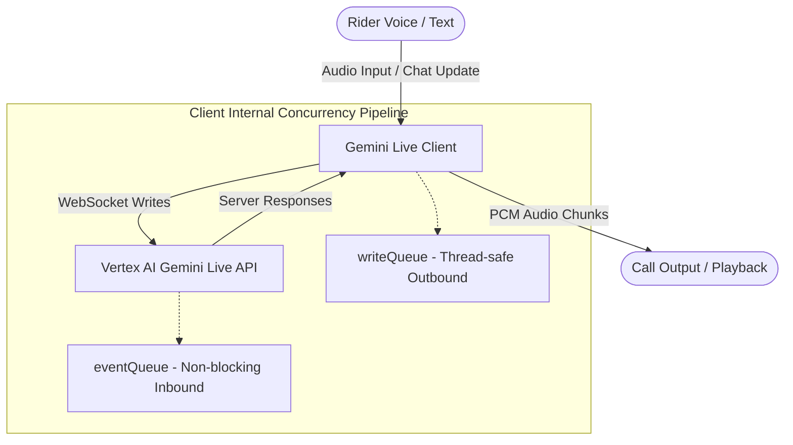
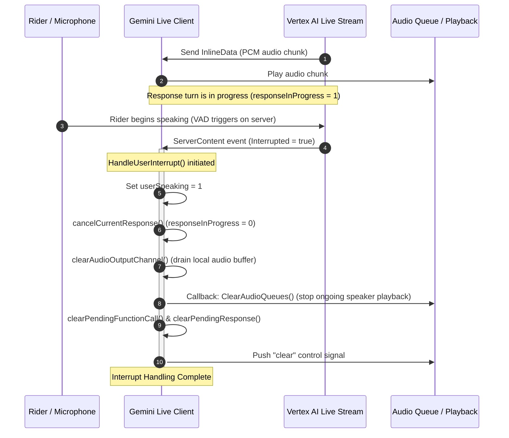

# Architectural Design: Gemini Live Client — RiderMate

This document details the architectural layout, concurrency pipeline, and reactive message handling of the `GeminiLiveClient` in the `RiderMate-Bot-Service` module.

---

## 1. System Overview

The `GeminiLiveClient` acts as a real-time, low-latency interface connecting downstream call layers (like a SIP/telephony network, mobile app audio stream, or WebRTC client) to **Google Cloud Vertex AI's Gemini Live API** (v1beta1). The client operates as a full-duplex streaming pipeline, handling incoming audio from the delivery rider while simultaneously rendering streaming model audio and driving conversational tool invocations (such as order cancellations, store arrival checks, payout queries, and rider support escalation).



---

## 2. Concurrency & Goroutine Architecture

To prevent deadlocks and maintain sub-100ms latency, the `GeminiLiveClient` isolates I/O and event processing into **four dedicated background goroutines** spawned immediately upon `Connect()`:

```
                  ┌─────────────────────────────────────────┐
                  │                 Connect()               │
                  └────────────────────┬────────────────────┘
                                       │
         ┌───────────────────┬─────────┴─────────┬───────────────────┐
         ▼                   ▼                   ▼                   ▼
┌─────────────────┐ ┌─────────────────┐ ┌─────────────────┐ ┌─────────────────┐
│receiveResponses │ │processEventQueue│ │  websocketWrites│ │    heartbeat    │
│  (Incoming I/O) │ │ (Event Handler) │ │  (Outgoing I/O) │ │  (Liveness Log) │
└─────────────────┘ └─────────────────┘ └─────────────────┘ └─────────────────┘
```

### A. `receiveResponses` (Incoming Network I/O)
*   **Purpose**: Constantly polls the Vertex AI GRPC stream via `session.Receive()`.
*   **Behavior**: Non-blocking. Immediately queues the received raw `LiveServerMessage` onto the internal `eventQueue`. If the buffer fills up, it dispatches a separate goroutine to process it directly to avoid choking the socket.

### B. `processEventQueue` (Event Dispatcher)
*   **Purpose**: Consumes from `eventQueue` sequentially to process messages in chronological order.
*   **Behavior**: Parses the message type (e.g. `ServerContent`, `ToolCall`, `SessionResumptionUpdate`) and dispatches to helper handlers like `processServerResponse`.

### C. `handleWebSocketWrites` (Outgoing Network I/O)
*   **Purpose**: Flushes queued outbound messages from `writeQueue` through a single, thread-safe mutex (`writeMu`).
*   **Behavior**: Serializes and sends `SendRealtimeInput`, `SendClientContent`, or `SendToolResponse` messages. This ensures that concurrent callers (e.g., streaming audio frames and tool responses) don't trigger simultaneous write conflicts on the underlying stream.

### D. `heartbeat` (Liveness)
*   **Purpose**: Every 30 seconds, logs a heartbeat metrics check to ensure the stream state and underlying channels are active.

---

## 3. Reactive State Management & VAD Interruption

One of the most complex tasks of a real-time voice assistant for riders is **Voice Activity Detection (VAD) barge-in / interruption**. If the model is speaking and the rider interrupts with an urgent update (e.g., traffic alert or arrived at store), playback must stop instantly, and buffered output on both server and client sides must be cleared.

### Interruption Sequence Diagram



---

## 4. Thread-Safe State Trackers

The client coordinates complex transactional flows via atomic states:
*   `connected` (Connection State): Determines if connection paths are open.
*   `userSpeaking` (Speaking State): Checked atomically to discard model audio-deltas received immediately after an interrupt occurs.
*   `responseInProgress`: Coordinates queuing of tool responses. If a tool completes while a previous response is playing, the response is buffered inside `pendingResponse` and delayed until the turn finishes to maintain structural flow.

---

## 5. End-to-End Conversation & Turn Flow

The system coordinates speech transcripts, live audio bytes, custom tool invocations, and telemetry updates in a highly choreographed sequence. Below is the comprehensive end-to-end communication protocol between the **Preact Frontend**, **Go WebSocket Proxy Server**, and the **Gemini Live API (Vertex AI)**.

### Communication Flow Diagram

```mermaid
sequenceDiagram
    autonumber
    participant Browser as Preact Frontend (Browser)
    participant Proxy as Go Proxy Server (main.go)
    participant Gemini as Gemini Live API (Vertex AI)

    Note over Browser,Proxy: 1. Connection Initialization
    Browser->>Proxy: Establish WebSocket Connection
    alt Live Mode Active
        Proxy->>Gemini: Establish Bidirectional GRPC Session
        Proxy->>Browser: status {"text": "connected_live"}
        Proxy->>Browser: event {"type": "connection", "text": "Session Active: Live GCloud..."}
    else Sandbox Fallback
        Proxy->>Browser: status {"text": "connected_sandbox"}
        Proxy->>Browser: event {"type": "connection", "text": "Session Active: Offline Sandbox..."}
    end

    Note over Browser,Gemini: 2. Rider Speaking Turn
    Browser->>Proxy: Send 16kHz Mono PCM Audio chunks (mic)
    Proxy->>Gemini: Relay Audio to Gemini Stream
    Gemini->>Proxy: InputTranscription incremental chunk
    Proxy->>Browser: stream_transcript_user {"text": "cancel order..."}
    Note over Browser: Incremental rider transcript bubble updates

    Gemini->>Proxy: TurnComplete Event (Rider finished speaking)
    Proxy->>Browser: transcript_user {"text": ""} [Finalize User Turn]
    Note over Browser: User bubble is locked (isFinal = true). Next user input spawns a new bubble.

    Note over Browser,Gemini: 3. Assistant Generating Turn
    Gemini->>Proxy: ServerContent chunk (audio & transcript)
    Proxy->>Browser: audio {"data": "<base64_PCM>"}
    Proxy->>Browser: stream_transcript_assistant {"text": "Checking order status..."}
    Note over Browser: Equalizer animates; Speaker plays crackle-free PCM chunks

    Gemini->>Proxy: Usage Metadata (metrics)
    Proxy->>Browser: metrics {"tokenDetails": [...]} [Update Modality Ticker]

    Gemini->>Proxy: TurnComplete Event (Assistant finished speaking)
    Proxy->>Browser: transcript_assistant {"text": ""} [Finalize Assistant Turn]
    Note over Browser: Assistant bubble is locked (isFinal = true). Next generation spawns a new bubble.

    Note over Browser,Gemini: 4. Tool Invocation & Execution
    Gemini->>Proxy: ToolCall request (e.g. OrderCancellationAgent)
    Proxy->>Browser: tool_call {"toolName": "OrderCancellationAgent", "toolArgs": {...}}
    Proxy->>Browser: event {"type": "tool_call", "text": "Tool Invoked: OrderCancellationAgent"}
    Note over Browser: Tool logs are rendered; styled Glassmorphic Tool Invoked Pill is shown

    Proxy->>Proxy: ExecuteTool(OrderCancellationAgent) -> JSON Mock Result
    Proxy->>Browser: event {"type": "tool_response", "text": "Tool Complete: OrderCancellationAgent -> SUCCESS"}
    Note over Browser: Styled Glassmorphic Tool Complete Pill is shown

    Proxy->>Gemini: Send Tool Response Input
    Gemini->>Proxy: Playback Speech with tool result
    Proxy->>Browser: audio {"data": "<base64_PCM>"} + stream_transcript_assistant
```
